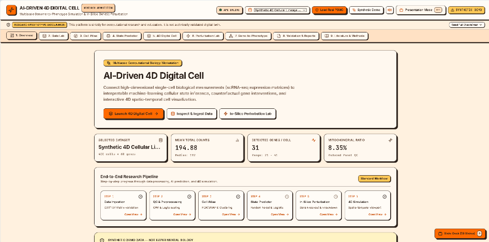
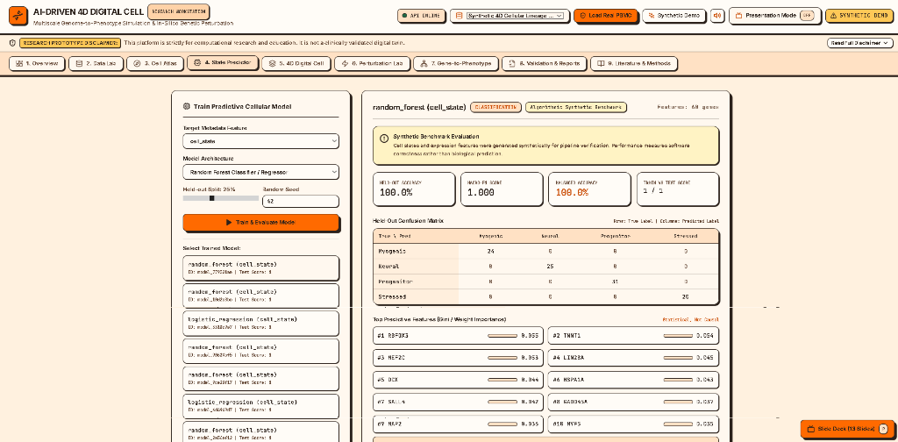
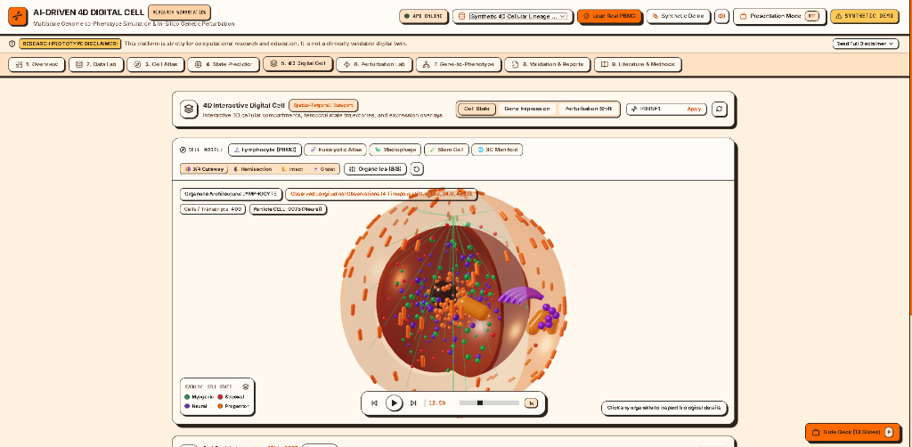

# AI-Driven 4D Digital Cell
## Multiscale Genome-to-Phenotype Simulation, Cellular State Prediction, and In-Silico Genetic Perturbation

> **REGULATORY & CLINICAL RESEARCH DISCLAIMER**  
> *RESEARCH & EDUCATION PROTOTYPE ONLY:* This computational biology workstation is designed for research hypothesis generation, exploratory analysis, and education. It is not a clinically validated digital twin and must not be used independently for clinical diagnosis, treatment decisions, or patient care. Simulated gene interventions represent mathematical model counterfactuals rather than proven wet-lab causal mechanisms.

---

## 1. Project Purpose & Scientific Background

The **AI-Driven 4D Digital Cell** connects single-cell transcriptomic data (scRNA-seq expression matrices) to interpretable machine-learning cellular state inference, in-silico genetic perturbation experiments, and interactive time-aware 3D cellular visualization.

Traditional single-cell analysis isolates dimensionality reduction from functional prediction and spatial representation. This platform integrates the entire computational biology lifecycle into a unified, reproducible research workstation:

$$\text{Data Ingestion} \longrightarrow \text{Quality Control} \longrightarrow \text{Preprocessing} \longrightarrow \text{Manifold Analysis} \longrightarrow \text{AI Model Training} \longrightarrow \text{Perturbation Simulation} \longrightarrow \text{4D Spatial Rendering} \longrightarrow \text{Reproducible Reporting}$$

---

## 📸 Workstation Screenshots

### 1. Workstation Overview & Pipeline Monitor
*High-level workstation overview displaying active dataset metrics, QC filtration thresholds, and the end-to-end research pipeline.*



### 2. Machine Learning Cellular State Predictor
*Supervised Random Forest & regularized classifiers with stratified evaluation, confusion matrix, ROC/F1 metrics, and Gini feature importance rankings.*



### 3. Interactive 4D WebGL Digital Cell Viewport
*Real-time 3D cellular morphology with plasma membrane, organelles, 4D longitudinal timepoint progression (0h–48h), and cell-state trajectory overlays.*



---

## 2. Implemented Features (9 Working Modules)

| Module | Features & Capabilities |
| :--- | :--- |
| **1. Overview** | Active dataset monitor, library size & mitochondrial ratio cards, end-to-end pipeline tracker, quick actions. |
| **2. Data Lab** | CSV/TSV expression matrix upload, orientation auto-detection (`cells_by_genes` vs `genes_by_cells`), duplicate disambiguation, matrix preview, configurable QC filters (min genes, max mito %, CPM normalization, log1p, HVG selection). |
| **3. Cell Atlas** | Interactive 2D manifold embeddings (PCA & UMAP fallback), categorical & gradient coloring, K-Means clustering, Welch's t-test differential marker genes, single-cell metadata inspector. |
| **4. State Predictor** | Supervised machine learning (Random Forest Classifier/Regressor, regularized Logistic/Ridge), stratified held-out evaluation, confusion matrix, ROC/F1/R² metrics, Gini feature importance rankings. |
| **5. 4D Digital Cell** | Interactive Three.js WebGL 3D cellular viewport: plasma membrane (prolate ellipsoid), nucleus (central sphere), and cytoplasm; 4D longitudinal time slider (0h, 12h, 24h, 48h) with play/pause and playback speed controls; overlays for cell states, active gene expression, and perturbation shift. |
| **6. Perturbation Lab** | In-silico genetic counterfactuals (Knockout $0\times$, Down-regulation $0.1-0.9\times$, Up-regulation $1.2-5.0\times$); state shift distribution delta tables, cell transition tracking, and mandatory counterfactual warnings. |
| **7. Gene-to-Phenotype** | Multi-scale evidence synthesis linking molecular features, expression abundance, phenotypic correlations ($r$), model importance ranks, and perturbation impacts with explicit evidence provenance tags. |
| **8. Validation & Reports** | End-to-end audit report generator compiling dataset provenance, QC filtering, model metrics, and perturbation tables into downloadable Markdown (`.md`) and JSON (`.json`) files. |
| **9. Literature & Methods** | Peer-reviewed citations (Cell, Nature Methods, Genome Biology) with direct DOI and PMID links; explicit distinction between verified published claims and prototype implementation assumptions. |

---

## 3. Architecture & Technology Stack

```
AI-Driven 4D Digital Cell Workstation
│
├── frontend/ (Vite + React 18 + TypeScript + Tailwind CSS)
│   ├── src/components/
│   │   ├── Header.tsx                 # Branding, dataset selector, synthetic badge
│   │   ├── Navigation.tsx             # 9-module tab switcher
│   │   ├── DisclaimerBanner.tsx       # Expandable regulatory warning
│   │   ├── ScatterPlot.tsx            # High-performance Canvas 2D manifold plot
│   │   └── ThreeDCellViewer.tsx       # Three.js 3D/4D cellular viewport & orbit controls
│   ├── src/features/                  # 9 modular feature views
│   └── src/lib/api.ts                 # Fully typed REST API client
│
├── backend/ (Python 3.11 + FastAPI + Pydantic v2)
│   ├── app/core/                      # Configuration, paths, SQLite persistence
│   ├── app/schemas/                   # Typed Pydantic request/response models
│   ├── app/services/                  # Scientific compute (QC, Prep, ML, 4D, Perturb, Reports)
│   ├── app/api/                       # Modular FastAPI route endpoints
│   └── tests/                         # Pytest automated test suite (17 tests)
│
└── data/                              # Local dataset store, models, and markdown reports
```

---

## 4. Quickstart & Installation

### Prerequisites
- **Python 3.11+**
- **Node.js 18+** & **npm**

### Step 1: Install Dependencies

#### Backend
```powershell
# From project root
python -m pip install -r backend/requirements.txt
```

#### Frontend
```powershell
cd frontend
npm install
cd ..
```

---

### Step 2: Run the Application Locally

#### Terminal 1 — Start the FastAPI Backend (Port 8000)
```powershell
# Windows PowerShell
$env:PYTHONPATH = "c:\Users\balaj\OneDrive\Desktop\4D Digitel Cell"; python -m uvicorn backend.app.main:app --host 127.0.0.1 --port 8000

# macOS / Linux
export PYTHONPATH=.
python3 -m uvicorn backend.app.main:app --host 127.0.0.1 --port 8000
```
Backend API interactive documentation is available at: `http://127.0.0.1:8000/docs`

#### Terminal 2 — Start the Vite Frontend (Port 3000)
```powershell
cd frontend
npm run dev
```
Open your browser at: **`http://127.0.0.1:3000`**

---

### Running with Docker & Docker Compose
```bash
docker-compose up --build
```
- Frontend: `http://localhost:3000`
- Backend API: `http://localhost:8000`

> **Note on Environment Deployment**: If Docker or Docker Desktop is not installed on the host machine, use the native Python and Node.js commands above, which are fully verified and operational.

---

### 5. Running Automated Acceptance & Regression Tests

Execute the complete test suite (**43 tests** covering software correctness, synthetic demonstrations, real-data PBMC 3k smoke tests, whole-transcriptome QC, label provenance, circular evaluation safeguards, temporal/spatial semantics, and audit regressions):

```powershell
# Windows PowerShell
$env:PYTHONPATH = "c:\Users\balaj\OneDrive\Desktop\4D Digitel Cell"; python -m pytest backend/tests -v

# macOS / Linux
PYTHONPATH=. pytest backend/tests -v
```

Build and validate the frontend production bundle (TypeScript & Vite):
```powershell
cd frontend
npm run build
```

Detailed audit and validation findings are documented in:
- [docs/SCIENTIFIC_FUNCTIONAL_AUDIT.md](docs/SCIENTIFIC_FUNCTIONAL_AUDIT.md)
- [docs/REAL_DATA_VALIDATION.md](docs/REAL_DATA_VALIDATION.md)

---

## 6. Real-Data Validation Benchmark: 10x Genomics PBMC 3k

The workstation includes a fully integrated, documented real-data validation workflow based on the canonical **10x Genomics PBMC 3k single-cell RNA-sequencing dataset**:
- **Published Citation**: Zheng, G. X. Y. et al. (2017). *Massively parallel digital transcriptional profiling of single cells*. **Nature Communications**, 8:14049. [DOI: 10.1038/ncomms14049](https://doi.org/10.1038/ncomms14049).
- **Biological Organism**: Primary human peripheral blood mononuclear cells (*Homo sapiens*).
- **Assay Technology**: 10x Chromium Single Cell 3' RNA-seq (v1 chemistry).
- **Licensing**: Open Access / Creative Commons Attribution (CC-BY 4.0).
- **Whole-Transcriptome QC (32,738 genes $\times$ 2,700 cells)**:
  - **Mean Total Counts / Cell**: **2,366.90**
  - **Median Detected Genes**: **817**
  - **Authentic Mitochondrial Fraction**: **2.22%** across all 13 human mitochondrial protein-coding genes (`MT-ND1` through `MT-CYB`).
  - **Viable Cells Filtered**: **2,643 / 2,700 droplets (97.9%)** pass criteria ($\ge 200$ detected genes, $\le 5.0\%$ mito, $\ge 500$ counts).
- **Validation Fixture**: 250 primary cells $\times$ 80 biologically curated genes containing canonical immune markers (`CD3D`, `CD4`, `CD8A`, `MS4A1`, `CD14`, `GNLY`, `PPBP`) and 9 authentic mitochondrial genes.
- **Label Provenance & Circular Evaluation Safeguard**:
  - Cell-state labels are audited and classified strictly as `computational_heuristic` (`is_independent_ground_truth: false`).
  - Because marker genes used for labeling overlap with model features, the workstation automatically detects **Circular Evaluation Risk** (`circular_evaluation_risk: true`).
  - Model metrics are labeled as **"Weak-Label Concordance (Computational Heuristic)"** to prevent conflating internal heuristic consistency with independent biological ground truth.
- **Temporal Status**: Cross-sectional clinical snapshot (`is_longitudinal: false`, `timepoint = 0.0h`). The system explicitly presents a snapshot status badge and does not extrapolate false longitudinal trajectories.

### How to Load the Real Benchmark Dataset:
- **In the UI**: Click **Load Real PBMC** in the workstation header.
- **Via API**:
  ```powershell
  Invoke-RestMethod -Uri "http://127.0.0.1:8000/api/real-data/initialize" -Method Post
  ```
- **From Source**:
  ```powershell
  python backend/scripts/prepare_real_pbmc_dataset.py
  ```

---

## 7. End-to-End User Walkthrough

1. **Load Real Biological Data**: Click **Load Real PBMC** in the top bar to load 250 cells from the 10x Genomics PBMC 3k dataset. The UI displays the green **REAL DATA (10x PBMC)** badge with whole-transcriptome QC scope.
2. **Inspect & Preprocess (Data Lab)**: Review authentic total count distribution (mean 2,367 counts) and whole-transcriptome mitochondrial fraction (2.22%). Run QC filtering and log1p normalization.
3. **Explore the Immune Manifold (Cell Atlas)**: View 2D PCA or UMAP projections separating T cells, B cells, Monocytes, and NK cells. Recluster using K-Means and inspect FDR-adjusted marker genes.
4. **Train Predictive Model (State Predictor)**: Train a multi-class Logistic Regression or Random Forest on `cell_state`. Inspect held-out metrics with the **Weak-Label Concordance** badge and circular evaluation disclosure.
5. **Simulate In-Silico Perturbation (Perturbation Lab)**: Perturb T cell marker `CD3D` (Knockout $0\times$). Observe mathematical state transitions and review the mandatory counterfactual disclaimer.
6. **Interact with the 4D Cell (4D Digital Cell)**: Inspect 3D conceptual PCA embeddings inside the cellular compartment. Observe that cross-sectional data correctly reports a snapshot without fabricated longitudinal animation. Click individual cell particles to inspect single-cell expression.
7. **Export Reproducible Report (Validation & Reports)**: Generate an audit report containing authentic dataset citation (Zheng et al., 2017), whole-transcriptome QC metrics, label provenance, circular evaluation disclosure, and limitations. Export predictions and perturbation results as CSV.

---

## 7. Supported Input Formats & Validation Rules

- **Expression Matrix**: CSV or TSV file containing cell identifiers and gene symbols.
- **Orientation**: Automatic detection of orientation. Supports both:
  - `cells_by_genes` (cells as rows, genes as columns)
  - `genes_by_cells` (genes as rows, cells as columns; automatically transposed internally)
- **Cell Metadata (Optional)**: CSV containing `cell_id`, `cell_state`, `timepoint_hours`, `spatial_x`, `spatial_y`, `spatial_z`.
- **Validation**: Automatically disambiguates duplicate row/column names, coerces non-numeric values to `0.0`, fills missing entries, and flags empty rows.

---

## 8. Verified Peer-Reviewed Scientific Literature

1. **Karr JR et al.** (2012). *A whole-cell computational model predicts phenotype from genotype.* **Cell**, 150(2):389–401. [DOI: 10.1016/j.cell.2012.05.044](https://doi.org/10.1016/j.cell.2012.05.044).
2. **Wolf FA, Angerer P, Theis FJ.** (2018). *Scanpy: large-scale single-cell gene expression data analysis.* **Genome Biology**, 19(1):15. [DOI: 10.1186/s13059-017-1382-0](https://doi.org/10.1186/s13059-017-1382-0).
3. **Dixit A et al.** (2016). *Perturb-seq: Dissecting Molecular Circuits with Scalable Single-Cell RNA Profiling of Pooled Genetic Screens.* **Cell**, 167(7):1853–1866. [DOI: 10.1016/j.cell.2016.11.038](https://doi.org/10.1186/s13059-017-1382-0).
4. **Lotfollahi M, Wolf FA, Theis FJ.** (2019). *scGen predicts single-cell perturbation responses.* **Nature Methods**, 16(8):715–721. [DOI: 10.1038/s41592-019-0494-6](https://doi.org/10.1038/s41592-019-0494-6).
5. **Stuart T et al.** (2019). *Comprehensive Integration of Single-Cell Data.* **Cell**, 177(7):1888–1902. [DOI: 10.1016/j.cell.2019.05.031](https://doi.org/10.1016/j.cell.2019.05.031).

---

## 9. Methodological Limitations & Known Assumptions

- **Mathematical Counterfactuals**: In-silico knockouts alter numerical feature inputs; they do not simulate chromatin accessibility, post-translational modifications, or proteomic feedback.
- **Statistical Feature Importance**: Gini importance or regression weights represent predictive signal within the dataset, not physical or causal interactions.
- **Conceptual Geometry**: Unless explicit microscopy coordinates are uploaded, the 3D cell boundaries (membrane, nucleus) and particle arrangements represent stylized abstractions.
- **Computational Clusters**: Unsupervised K-Means clusters represent transcriptomic distance groupings and must not be interpreted as validated in-vivo cell types without orthogonal markers.

---

## 10. License
Academic Research and Educational Use License.
